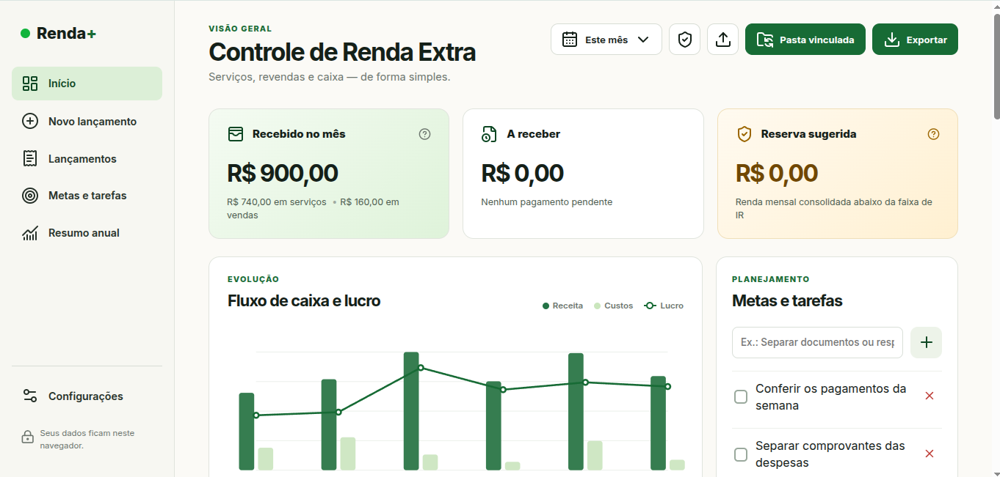
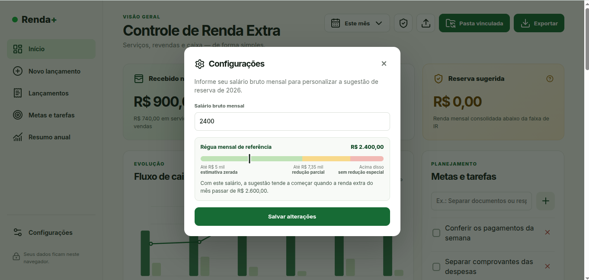
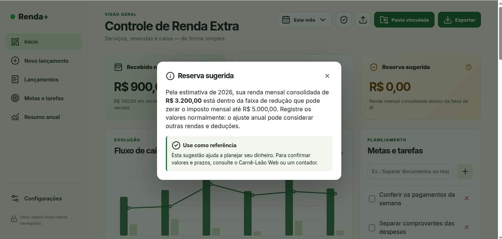
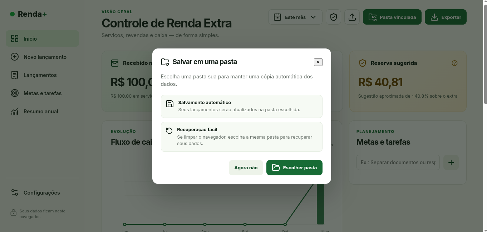

# Renda+



[](https://www.linkedin.com/in/lucio-danilo-490a72110/)

**Renda+** é um controle simples de renda extra. Ele ajuda a registrar serviços, vendas e custos, enxergar a evolução mensal e se organizar para uma possível reserva de Imposto de Renda — sem tentar substituir o Carnê-Leão Web ou um contador.

**[Abrir e usar online](https://ldanilo-ambrosio-so.github.io/controle-rendaextra/)** · **[Baixar para o computador](https://github.com/ldanilo-ambrosio-so/controle-rendaextra/releases/latest/download/Renda-mais.zip)**

## Telas do aplicativo

| Visão geral | Configuração da referência de IR |
| --- | --- |
|  |  |

| Reserva sugerida | Pasta e recuperação de dados |
| --- | --- |
|  |  |

## O que o app faz

- Registra serviços, vendas e lançamentos não tributáveis em poucos segundos.
- Mostra o recebido no mês, custos, lucro nas vendas e a evolução dos últimos seis meses.
- Mantém uma lista simples de metas e tarefas.
- Gera um resumo anual e exporta os lançamentos em CSV, com termos em português.
- Salva os dados no navegador e, opcionalmente, em uma pasta escolhida pelo usuário.

## Reserva sugerida de IR

O card **Reserva sugerida** é uma referência de planejamento, não uma guia de imposto a pagar.

1. Nas configurações, informe o salário bruto mensal.
2. O app considera o salário junto da renda extra líquida do mês: serviços menos os custos informados e lucro das vendas.
3. Ele compara o imposto estimado com e sem a renda extra. A diferença é o valor sugerido para separar.

Para a estimativa de 2026, o cálculo aplica a dedução simplificada mensal, a tabela progressiva do IRPF e a redução prevista para rendimentos mensais de até R$ 7.350,00. Até R$ 5.000,00 de renda mensal consolidada, a estimativa pode ficar em **R$ 0,00**. Por exemplo: com salário de R$ 2.400,00, a régua indica que a sugestão tende a começar quando a renda extra do mês ultrapassar R$ 2.600,00.

Isso não garante isenção na declaração anual. Outras fontes de renda, descontos, deduções, a natureza do recebimento e regras específicas podem mudar o resultado. Confirme a apuração no [Carnê-Leão Web](https://www.gov.br/pt-br/servicos/apurar-carne-leao/) ou com um contador.

## Salvar e recuperar os dados

Os lançamentos ficam primeiro neste navegador. Para ter uma cópia fora dele, use **Vincular pasta** no topo do app e escolha uma pasta sua. O Renda+ atualiza nela:

- `lancamentos.json`: lançamentos, tarefas e salário configurado;
- `lancamentos.csv`: uma planilha para consulta ou envio ao contador.

Se limpar o navegador, abra o app e escolha novamente a mesma pasta: os dados são recuperados a partir do arquivo JSON.

## Como usar

### No computador

Abra [index.html](index.html) no navegador. Ele é autossuficiente: a interface e a lógica já estão incorporadas no arquivo.

### Pela web

Este repositório pode ser publicado no GitHub Pages. Após a publicação, basta abrir o endereço do projeto no navegador. Mesmo usando a versão online, os dados continuam privados no navegador de cada pessoa e, se vinculada, na pasta que ela escolheu. Não há conta, servidor, banco de dados remoto ou compartilhamento automático na nuvem.

> O recurso **Vincular pasta** depende da File System Access API. Ele funciona em navegadores baseados em Chromium, como Chrome, Edge e versões compatíveis do Brave. Quando não houver suporte, os botões de backup e importação continuam disponíveis.

### Para desenvolver

Edite `app.js` e `styles.css`, depois incorpore as alterações no `index.html` para preservar o uso como arquivo único. Para testar com um servidor local, execute:

```bash
./iniciar-app.sh
```

## Tecnologias

- HTML5, CSS3 e JavaScript puro
- Lucide Icons
- Google Fonts (Inter)
- LocalStorage e File System Access API opcional

## Licença

Este projeto permanece sob a licença [MIT](LICENSE).

Desenvolvido por **[Lucio Danilo](https://github.com/ldanilo-ambrosio-so)**.
